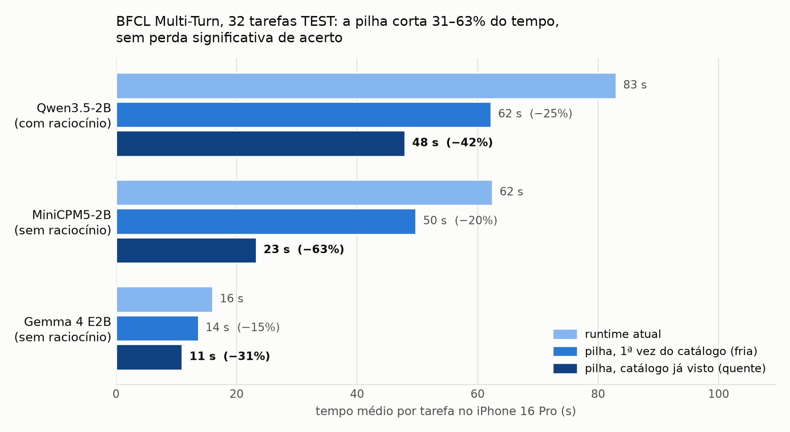

# Agentes de LLM pequenos, rápidos, no iPhone

Este repositório é o TCC da residência: **como fazer um modelo de linguagem pequeno (SLM, ~2B parâmetros) usar
ferramentas, em tarefas de vários passos, rodando inteiro no iPhone, e rápido.**

## O resultado principal

Montamos uma **pilha de runtime**, com o *prefixo persistente* mais a *DAC com guardas de decode*. Nas 32 tarefas
TEST do BFCL Multi-Turn, nunca usadas para ajustar nada, ela deixou três SLMs **31% a 63% mais rápidos por tarefa**
no iPhone 16 Pro, **sem perda significativa de acerto**. O protocolo e os hashes do código foram congelados antes da
execução.



| Modelo | Antes (s/tarefa) | Com a pilha (s/tarefa) | Ganho | Acerto antes → depois |
|---|---|---|---|---|
| Qwen3.5-2B (com raciocínio) | 83,0 | **48,0** | **−42%** (IC95% −48 a −25 s) | 8/32 → 7/32 |
| MiniCPM5-2B (sem raciocínio) | 62,5 | **23,3** | **−63%** (IC95% −50 a −31 s) | 9/32 → 9/32 |
| Gemma 4 E2B (sem raciocínio) | 16,0 | **11,0** | **−31%** (IC95% −5,6 a −4,5 s) | 2/32 → 2/32 |

*"Com a pilha" = catálogo de ferramentas já visto, o caso normal num app. Na primeira vez de um catálogo, o ganho é
de 15% a 25%.*

**Relatório completo:** [`reports/runtime/README.md`](reports/runtime/README.md). Lá estão a explicação da técnica,
o caminho até ela, os resultados negativos e como reproduzir.

## A ideia em 30 segundos

Um agente faz vários passos por tarefa. Em cada passo, o modelo **lê** o prompt (prefill) e **escreve** a resposta
(decode). Com o cache incremental, que já é a nossa referência, sobravam dois gargalos:

1. **Ler de novo o catálogo de ferramentas** (~4,7 mil tokens, ~9–15 s) no começo de cada tarefa.
   → **Prefixo persistente:** o estado do modelo depois de ler "sistema + ferramentas" é gravado em disco e
   recarregado em ~15–70 ms. A saída é idêntica à sem prefixo.
2. **Raciocínio e laços que não terminam**, quase sempre nas tarefas que o modelo vai errar.
   → **DAC + guardas:** fecha o raciocínio em 512 tokens, corta chamadas repetidas e dá ao modelo uma única chance de
   sair de um laço antes de encerrar o turno.

Cada peça ataca um gargalo diferente, e por isso os ganhos se somam: sem raciocínio (Gemma 4, MiniCPM5), o ganho vem
do prefixo; com muito raciocínio (LFM2.5), vem da DAC; o Qwen3.5 tem os dois. No DEV, a pilha também acelerou o
**LFM3-1.7B** (−32%), o modelo que mais acertou até agora: 6/12, contra 4/12 do Qwen3.5 no mesmo build.

## Como chegamos aqui

| Fase | O que foi feito | Onde |
|---|---|---|
| Semanas 1–4 | Revisão bibliográfica; fatia BFCL em GPU (vLLM) | [semanário](reports/weekly/README.md), [GPU](mobile-adaptive-inference/results/relatorio-bfcl.md) |
| Semanas 5–7 | App iOS, ferramentas reais do iPhone, roteamento adaptativo Direct × Plan+Act | entrega 08/10 (no git: `git show 5d75709:docs/entrega_2026-10-08.txt`), [roteamento](reports/adaptive-routing/v3/REPORT.md) |
| Semana 8 | Quatro SLMs × BFCL v4 AST (turno único), 880 execuções | [relatório](reports/weekly/2026-W44/README.md) |
| Nov/2026 | BFCL Non-Live: Direct × Reasoning e orçamentos de raciocínio | [reports/bfcl-nonlive/](reports/bfcl-nonlive/) |
| Nov/2026 | **BFCL Multi-Turn no iPhone: cache, DAC, prefixo persistente, pilha, TEST** | **[reports/runtime/](reports/runtime/README.md)**, [reports/dac/](reports/dac/) |
| Nov/2026 | LoRA de SFT agêntico do autor: integrado e medido (piora o acerto no BFCL-MT; ver o relatório) | [reports/runtime/](reports/runtime/README.md#o-que-não-funcionou-e-entra-no-tcc-como-resultado-negativo) |

A semana 1 teve um MVP Android (LiteRT), que foi retirado deste repositório porque o trabalho seguiu só no iPhone. Ele
continua no histórico do git: `git log -- AndroidLLMBench`. O mesmo vale para a antiga pasta `docs/` (plano de 29/09 e
entrega de 08/10): `git log -- docs`.

## Onde está cada coisa

| O que procurar | Caminho |
|---|---|
| **Estudo principal (técnica, resultados, protocolos)** | [`reports/runtime/`](reports/runtime/README.md) |
| Estudo DAC (laços, recuperação, diagnósticos de cache e decode) | [`reports/dac/`](reports/dac/) |
| Relatórios semanais e anteriores | [`reports/weekly/`](reports/weekly/README.md), [`reports/`](reports/) |
| Resultados brutos (não editar) | [`results/`](results/); BFCL Multi-Turn em `results/bfcl-mt/dac/<rodada>/` |
| Scripts de análise e runners (Mac) | [`analysis/`](analysis/README.md); runtime em [`analysis/runtime/`](analysis/runtime/chains/README.md) |
| Fontes dos apps iOS | [`MobileLLMCore/`](MobileLLMCore), [`MobileLLMBench/`](MobileLLMBench), [`MobileLLMChat/`](MobileLLMChat) |

Inferência: iPhone 16 Pro. Harness, simulador de ferramentas, avaliação e gráficos: Mac.

## Reproduzir (sem iPhone)

```bash
# TEST final: tabelas, frio × quente e figura, a partir dos resultados gravados
BENCH_SLM=qwen35 .bfcl-venv/bin/python analysis/bfcl_mt/analyze_dac.py reports/runtime/test-qwen35.md tqA tqB \
  --conds rt-base-kv,dacs-persist-kv --ref rt-base-kv
python3 analysis/runtime/cold_warm.py reports/runtime/test-qwen35.json rt-base-kv dacs-persist-kv tqA tqB
python3 analysis/runtime/figures.py

# Relatório da Semana 8
python3 analysis/weekly/generate.py --check
```

Ambiente BFCL: `.bfcl-venv` com `pip install bfcl-eval==2026.3.23`. Para rodar no aparelho, veja as cadeias em
[`analysis/runtime/chains/`](analysis/runtime/chains/README.md). O progresso aparece na aba **Ao vivo** do app.

## Limitações

- **Acerto baixo:** SLMs de 2B acertam 2 a 9 das 32 tarefas Multi-Turn. A pilha acelera sem piorar, mas não sobe o
  acerto.
- **Uma rodada por condição no TEST;** comparações sempre pareadas na mesma sessão, por causa da térmica.
- **O ganho "quente" supõe catálogo de ferramentas repetido** (natural num app; no BFCL cada tarefa traz o seu).
- **Próximos passos possíveis:** TEST do LFM3-1.7B no build novo (o DEV já foi feito); escolher o modelo por tarefa (Qwen3.5
  e MiniCPM5 acertam tarefas diferentes); um SFT com trajetórias com estado.

## Dados não versionados

- `Google.xcconfig` / `*.xcconfig` / `.env`
- Estado de usuário do Xcode (`xcuserdata/`) e `DerivedData/`; os projetos em si estão em `ios/`
- Cabeça MTP do Qwen3.5 (tensores `mtp.*` do checkpoint oficial, copiados para o app)
- Conversas do chat no iPhone (`Chat/conversations.json`)
- Pesos dos modelos (baixados do Hugging Face pelo app na primeira execução)

---

# Apps iOS: MobileLLMBench e MobileLLMChat

Desde 2026-11-05 são dois apps separados, cada um com o próprio projeto Xcode (em `ios/`), que compartilham uma pasta de fontes:

| Pasta neste repo | Vai para | Conteúdo |
| --- | --- | --- |
| `MobileLLMCore/` | os dois apps | Backends (MLX e Apple Foundation Models), catálogo de modelos e estratégias, tools do sistema (`ToolRegistry`, `SystemTools`), roteador adaptativo, budget, `ThinkingFilter` |
| `MobileLLMBench/` | `ios/MobileLLMBench/` (mlx-swift-lm 3.31.4) e `ios/MobileLLMBench-mlxmain/` (mlx-swift-lm `main`) | Runner, matriz de experimentos, datasets Apple/BFCL, servidor OpenAI para o Mac, abas Executar, Ao vivo e Resultados |
| `MobileLLMChat/` | `ios/MobileLLMChat/` | Assistente de chat (`ChatView`, `ChatStore`, `AgentCoordinator`, tools de agenda, Google Calendar) |
| `MobileLLMBenchTests/`, `MobileLLMChatTests/` | o respectivo projeto | Testes de cada app |

Os projetos referenciam as pastas da raiz por grupos sincronizados (`../../MobileLLMCore` etc., sem Swift Package), então um arquivo em `MobileLLMCore/` compila em todos. Regra: nada em `MobileLLMCore/` pode importar tipos de `MobileLLMBench/` ou `MobileLLMChat/`.

## Como compilar

| Projeto | Biblioteca MLX | Para quê |
| --- | --- | --- |
| `ios/MobileLLMBench/MobileLLMBench.xcodeproj` | `mlx-swift-lm` 3.31.4 | build dos estudos até o TEST da pilha (2026-11-09/10) |
| `ios/MobileLLMBench-mlxmain/MobileLLMBench.xcodeproj` | `mlx-swift-lm` `ec4c966a` (`main`), flag `MLX_LM_MAIN` | LFM3 e a especulação MTP em pipeline (`MTPHead.swift`, `MTPPipeline.swift`, `MLXCompat.swift`) |
| `ios/MobileLLMChat/MobileLLMChat.xcodeproj` | `mlx-swift-lm` 3.31.4 | chat agêntico |

- **Assinatura:** troque o `DEVELOPMENT_TEAM` e o bundle ID para os seus.
- **Chat:** copie `ios/MobileLLMChat/Google.xcconfig.example` para `Google.xcconfig` (o git ignora esse arquivo) e
  preencha o client ID iOS do Google. Sem ele, só o login Google fica desligado.
- **Build `mlxmain` pela linha de comando:** `xcodebuild -project ios/MobileLLMBench-mlxmain/MobileLLMBench.xcodeproj
  -scheme MobileLLMBench -destination "id=<UDID>" -allowProvisioningUpdates -skipMacroValidation
  -skipPackagePluginValidation build`.
- **Cabeça MTP (só no `mlxmain`):** copie os tensores `mtp.*` do checkpoint oficial `Qwen/Qwen3.5-2B`, com o
  `config.json`, para `Documents/mtp/qwen35/` do app (`model.safetensors`).

A primeira versão (semana 5) comparou **direto** e **plano e ação** em três modelos: o `SystemLanguageModel` da Apple, `mlx-community/Qwen3-1.7B-4bit` e `mlx-community/gemma-4-e2b-it-4bit` (os dois últimos pelo MLX, `mlx-swift-lm` 3.31.4). Depois o app ganhou o protocolo 2, os datasets Apple e BFCL, estratégias de raciocínio, roteadores adaptativos e o chat agêntico (ver os relatórios em `reports/`).

## Ferramentas

| Tool | API da Apple | O que acontece |
| --- | --- | --- |
| `ligar` | `tel:` | Abre o Telefone e disca |
| `ligarFaceTime` | `facetime-audio:` | Abre o FaceTime áudio |
| `enviarEmail` | Gmail API (chat, conta Google) ou `googlegmail://` / `mailto:` | No chat envia direto pelo Gmail; sem conta, abre o Gmail ou Mail preenchido |
| `enviarMensagem` | `sms:` | Abre o Mensagens com o texto preenchido |
| `criarEvento` | EventKit | Grava um evento |
| `criarLembrete` | EventKit | Grava um lembrete |
| `abrirRota` | Waze / Google Maps / Apple Mapas (preferência do usuário) | Abre a navegação de carro já iniciada |
| `abrirApp` (só chat) | Links universais | Abre Instagram, Spotify, YouTube, Uber, X, TikTok, Telegram, LinkedIn, Netflix em perfil, busca ou destino |
| `rodarAtalho` (só chat) | `shortcuts://x-callback-url` | Roda um atalho do app Atalhos cadastrado nos ajustes do chat |
| `abrirSafari` | `https` | Abre a página no Safari |
| `buscarContato` | agenda sintética | Devolve o número de Ana, Bruno ou Carla; não lê os contatos do aparelho |

## Tarefas

| Tipo | Tarefas | Acerto |
| --- | --- | --- |
| `single_tool` | Ligar, FaceTime, E-mail, Mensagem, Calendário, Lembrete, Mapas, Safari | Chamou exatamente a ferramenta esperada |
| `multi_tool` | Evento + lembrete; Lembrete + mensagem | Chamou exatamente as duas ferramentas, em qualquer ordem |
| `sequential` | Contato → ligar; Contato → mensagem; Contato → lembrete → FaceTime | Chamou as ferramentas esperadas e a ação usou o número que só a busca devolve |

O acerto está em `PhoneTask.grade`; ferramenta repetida ou faltando conta como falha. Os números são `+15550100` a `+15550102`, o e-mail é `test@example.com`. Mail e Mensagens abrem o rascunho; o envio continua na mão de quem testa. Calendário e Lembretes gravam de verdade.

**Direto** manda o pedido já com as tools. **Plano e ação** gera um plano de até 128 tokens sem tools e só então gera com as tools, como em `strategies.py`. No MLX, o resultado de cada ferramenta volta ao modelo como mensagem `tool`, em até 4 rodadas; no modelo da Apple a `LanguageModelSession` faz esse ciclo sozinha. Amostragem gulosa nos três.

## Build no Xcode

1. Crie **iOS App → MobileLLMBench → SwiftUI / Swift**, sem armazenamento e sem testes.
2. **iOS Deployment Target = 26.0**, **Swift Language Version = Swift 6**, **Default Actor Isolation = Nonisolated**.
3. Adicione o pacote `https://github.com/ml-explore/mlx-swift-lm` (3.31.4) com `MLXLLM`, `MLXLMCommon` e `MLXHuggingFace`. Coloque no target todos os `.swift` de `MobileLLMBench/` e os datasets `BFCLSubset.json` e `BFCLv4AST.json`. Os testes de `MobileLLMBenchTests/` vão num target de testes. O chat com Google Calendar precisa de um `Google.xcconfig` próprio com `GOOGLE_IOS_CLIENT_ID` e `GOOGLE_IOS_REVERSED_CLIENT_ID` (não versionado).
4. No target, em Info, adicione:
   - `NSCalendarsFullAccessUsageDescription` = `O teste grava um evento para verificar a ferramenta de calendário.`
   - `NSRemindersFullAccessUsageDescription` = `O teste grava um lembrete para verificar a ferramenta de lembretes.`
5. Configure o **Signing Team**, conecte o iPhone, ative o Developer Mode se o sistema pedir e selecione o aparelho.
6. Ative o Apple Intelligence e espere o modelo do sistema ficar disponível.
7. Rode pelo Xcode. O projeto usado nos experimentos fica em um repositório separado (`MobileLLMBench.xcodeproj`) e compila os fontes desta pasta.
8. No app há três modos. **Demo** escolhe o modelo, a estratégia e uma tarefa. **Prompt** manda um texto livre com as mesmas ferramentas. **Matriz** roda 3 modelos × 2 estratégias × 13 tarefas = 78 execuções. Qwen e Gemma baixam na primeira execução e ficam um por vez na memória. **Export JSON** junta as execuções da sessão.

## Métricas por execução

Protocolo `2.0`. O array exportado continua sendo a lista de execuções; cada linha traz os campos antigos e os novos. Uma sessão incompleta fica em Application Support (`session.json`) e o app oferece continuar. Energia por tarefa não é calculada: o iOS não entrega joules, e a variação de bateria não entra como energia. O intervalo `task` do `OSSignposter` segue disponível para o Power Profiler.

Não some os tempos abaixo. Cada um cobre um intervalo diferente:

| Campo | O que mede |
| --- | --- |
| `modelLoadMs` | Carga ou download. Fica de fora de `totalLatencyMs`. |
| `thermalWaitMs` | Espera ociosa pela térmica. Fica de fora da latência e do intervalo `task`. |
| `prefillLatencyMs` | `promptTime` do primeiro turno de ação no MLX. Não inclui o plano. |
| `repeatedPrefillMs` | `promptTime` dos turnos de ação seguintes. Budget e early-exit reprocessam o prefixo; esse custo não entra em `prefillLatencyMs` nem em `decodeLatencyMs`. |
| `decodeLatencyMs` | Soma de `generateTime` dos turnos de ação. |
| `planLatencyMs` | Relógio de parede só do plano. |
| `toolExecutionMs` | Soma do corpo das tools. |
| `inferenceMs` / `timeToFirstToolCallMs` | Do modelo já residente até a primeira tool. |
| `totalLatencyMs` | Relógio de parede da tentativa, sem carga e sem espera térmica. |
| `totalMs` | O mesmo intervalo mais a carga. É o total do protocolo 1. |

Valor ausente fica `null`. A amostragem é gulosa (`temperature` 0). O seed gravado só reproduz a ordem da matriz; no MLX 3.31.4 ele não muda os tokens do argmax. A matriz embaralha as repetições, pode aquecer uma vez fora da análise e, se a opção estiver ligada, espera no máximo 180 s por térmica `nominal` ou `fair` antes de pular a tentativa.

## Fase 2 — ferramentas, simulação e trajetórias

O aquecimento da matriz é sempre simulado: o modelo carrega, mas as nove ferramentas não abrem Telefone, Mail, Calendário, Mapas nem Safari. A matriz legado pode ser real ou simulada. Os datasets Apple (150 tarefas: 40 de uma ferramenta, 40 independentes, 50 sequenciais, 20 ambíguas) e o subconjunto BFCL (20 tarefas, cinco em cada categoria `simple`, `multiple`, `parallel` e `parallel_multiple`) rodam só no modo simulado. Cada tarefa Apple tem fixtures próprias. O avaliador de trajetória confere seleção, argumentos, dependências, ordem e estado final por regras, sem outro modelo. `parallel` do BFCL não exige ordem fixa. O checker local usa a allow-list do `possible_answer` e trata `""` como argumento opcional; não é o `ast_checker` Python. O Apple Foundation Models não recebe o BFCL, porque as ferramentas daquele backend são estáticas.

## Energia no iPhone

O iOS não expõe potência para o app. Cada execução abre um intervalo `task` em Points of Interest (`OSSignposter`, subsystem `MobileLLMBench`), com modelo, estratégia e tarefa no rótulo. Para energia por tarefa:

1. Grave um trace com o template **Power Profiler** do Instruments enquanto a matriz roda, com o instrumento **Points of Interest** junto.
2. Selecione cada intervalo `task` e anote a energia do intervalo.
3. Energia por token = energia do intervalo ÷ `outputTokens` da mesma execução no JSON.

Essa parte é manual: nenhum script lê o trace.

