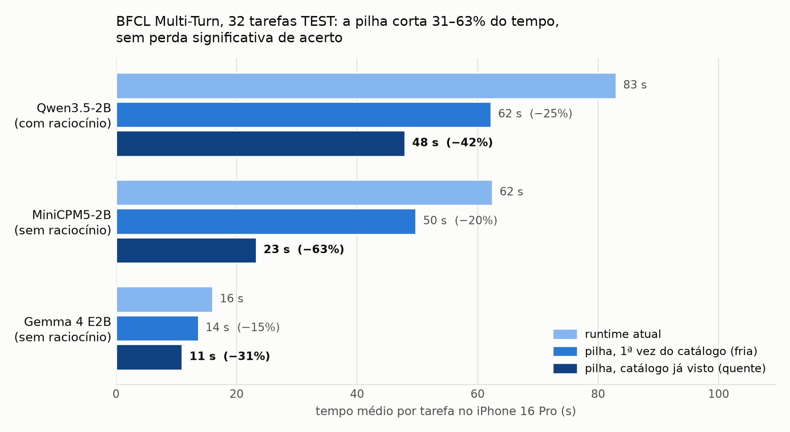

# Acelerando agentes de SLM no iPhone: a pilha de runtime

**Resultado.** Nas 32 tarefas TEST do BFCL Multi-Turn, nunca usadas para escolher nada, a pilha deixou três SLMs
**31% a 63% mais rápidos por tarefa** no iPhone 16 Pro, sem perda significativa de acerto. O protocolo foi congelado
antes da execução, com os hashes do código ([PROTOCOL-TEST.md](PROTOCOL-TEST.md)).



| Modelo (estratégia) | Acerto: atual → pilha | Atual (s/tarefa) | Pilha fria | **Pilha quente** | IC95% do Δ quente |
|---|---|---|---|---|---|
| Qwen3.5-2B (com raciocínio) | 8/32 → 7/32 | 83,0 | 62,2 (−25%) | **48,0 (−42%)** | [−47,9; −25,4] s |
| MiniCPM5-2B (sem raciocínio) | 9/32 → 9/32 | 62,5 | 49,8 (−20%) | **23,3 (−63%)** | [−49,5; −31,2] s |
| Gemma 4 E2B (sem raciocínio) | 2/32 → 2/32 | 16,0 | 13,7 (−15%) | **11,0 (−31%)** | [−5,6; −4,5] s |

O critério congelado tinha duas partes:
- o IC95% do Δ quente inteiro abaixo de zero;
- perda líquida de no máximo 1 de 32 tarefas, sem perda significativa.

Os três modelos passaram nas duas. No Qwen3.5, a pilha perdeu as tarefas 23 e 161 e ganhou a 12: perda líquida de 1,
McNemar p = 1,0. *Fria* é a primeira vez que um catálogo de ferramentas aparece. *Quente* é quando ele já foi visto,
que é o caso normal num celular, onde as ferramentas do app são sempre as mesmas.

## O problema

Um agente de tool calling no celular faz muitos passos por tarefa: chama uma ferramenta, lê o resultado e decide o
próximo passo. Cada passo tem duas partes:
- **prefill:** o modelo lê o prompt, ou seja, as instruções de sistema, o catálogo de ferramentas (~4,7 mil tokens no
  BFCL) e a conversa até ali. A ~515 tokens/s, só o catálogo custa ~9 s.
- **decode:** o modelo gera a resposta token a token (~43 tokens/s), incluindo o raciocínio.

Com o cache incremental (`kv`), o passo seguinte só lê o que é novo. Isso já é a referência ("runtime atual"):
sem ele, a mesma tarefa levava 380 s em vez de 65 s ([reports/dac](../dac/dev-r1-r3.md)). Sobravam dois gargalos:
1. no **primeiro passo de cada tarefa**, o catálogo é lido do zero;
2. **raciocínio e laços longos** no decode, quase sempre nas tarefas que o modelo vai errar.

## A técnica: duas peças, cada uma num gargalo

### 1. Prefixo persistente (ataca o prefill)

O estado do modelo depois de ler "sistema + ferramentas" é gravado em disco (`safetensors`, ~75–110 MB). Na próxima
tarefa com o mesmo catálogo, ele é carregado em ~15–70 ms, em vez de ~12–15 s de prefill.
- **A chave do arquivo** junta modelo, revisão, adaptador, binário do app e tokens, então um estado nunca serve a outro
  modelo.
- **Funciona em modelos híbridos.** O Qwen3.5 tem camadas de atenção linear (`MambaCache`), que não voltam atrás, e o
  LFM3 tem convolução e atenção em janela. O arquivo guarda o layout inteiro do cache e o número de estados de cada
  camada. Até 2026-11-10 as camadas de convolução da família LFM eram recusadas; ver a nota do LFM2.5 abaixo.
- **O texto gerado é idêntico ao sem prefixo** (324/324 passos no DEV).

Código: [`MobileLLMCore/PrefixStore.swift`](../../MobileLLMCore/PrefixStore.swift) e o uso no servidor em
`MobileLLMCore/MLXPhoneBackend.swift` (`serveConversation`).

### 2. DAC com guardas de decode (ataca o decode)

- **`think_budget` 512:** se o raciocínio passa de 512 tokens, o servidor fecha o `</think>` e a resposta continua do
  mesmo cache, sem reprocessar. Fechar à força preserva o formato da chamada (8/8 válidas no diagnóstico).
- **`repeat_guard`:** corta o decode quando a mesma chamada, com o mesmo nome e os mesmos argumentos, sai de novo na
  mesma resposta.
- **DAC** ([`analysis/bfcl_mt/dac.py`](../../analysis/bfcl_mt/dac.py)):
  - na 2ª repetição da mesma chamada ou no 2º erro seguido, injeta uma nota curta e dá uma tentativa extra;
  - se o modelo repetir de novo, encerra o turno.

  Nenhuma chamada extra de LLM.

As guardas ficam em `MobileLLMCore/ThinkBudget.swift` (`ServeGuards`) e chegam pelo corpo da requisição ao
[`InferenceServer`](../../MobileLLMBench/InferenceServer.swift).

### Por que as duas juntas

Cada peça ganha mais num tipo de modelo, e a pilha cobre os dois (DEV, [models-*.md](.)):

| Modelo no DEV | O que domina o tempo | Pilha fria | Pilha quente | Quem faz o ganho |
|---|---|---|---|---|
| Gemma 4 (sem raciocínio) | prefill | −6% | −28% | prefixo |
| LFM2.5 (raciocina muito, 283 s/tarefa) | decode | −46% | −44% | só DAC + guardas (ver nota) |
| Qwen3.5 (as duas coisas) | os dois | −24% | −43% | os dois somados |

**Nota sobre o LFM2.5:** nessa rodada, o prefixo persistente **não funcionou** para ele. O `PrefixStore` recusava o
cache de convolução da família LFM, que só usa um dos dois estados do `MambaCache`, e o prefixo foi montado do zero
nos 36 primeiros passos. O ganho do LFM2.5 é, portanto, só da DAC + guardas, o que explica fria ≈ quente. Isso foi
corrigido em 2026-11-10. O TEST (Qwen3.5, MiniCPM5, Gemma 4) não foi afetado: as 96 execuções quentes carregaram o
prefixo do disco.

No 2×2 do Qwen3.5 (DEV, 3 rodadas, [stack-all.md](stack-all.md)), o prefixo sozinho deu −8,3 s e a DACS sozinha
−18,3 s. A pilha deu −28,9 s, ou seja, os efeitos se somam.

## Como foi medido

- **Aparelho:** iPhone 16 Pro, app `MobileLLMBench` com `mlx-swift-lm` 3.31.4, modelos de 4 bits, greedy, teto de
  1024 tokens por passo.
- **Avaliação no Mac:** o Mac roda o harness, o simulador de ferramentas e o scorer oficiais do `bfcl-eval` 2026.3.23
  (`multi_turn_base`), falando com o iPhone por HTTP
  ([`run_eval.py`](../../analysis/runtime/run_eval.py), [`bfcl.py`](../../analysis/bfcl_mt/bfcl.py)).
- **Fatias congeladas** ([`results/bfcl-mt/slice.json`](../../results/bfcl-mt/slice.json)): 12 DEV para escolher e
  32 TEST para confirmar.
- **Pareamento:** cada tarefa roda em todas as condições, com a ordem girada, os KV em memória apagados antes de cada
  execução e espera até o iPhone sair da térmica `serious`.
- **Estatística:** Δ pareado por tarefa, IC95% bootstrap (10 000 reamostras); acerto com McNemar exato.

## LFM3-1.7B (build novo, DEV)

O LFM3 (LiquidAI, 2026-10-27) só roda com um `mlx-swift-lm` mais novo. Rodou num build separado
([PROTOCOL-lfm3.md](PROTOCOL-lfm3.md)), com uma camada de compatibilidade
([`MobileLLMCore/MLXCompat.swift`](../../MobileLLMCore/MLXCompat.swift)). **Os números deste build não se comparam
com os do build antigo**, porque mesmo o Qwen3.5 dá outra saída greedy nele. Por isso o Qwen3.5 rodou de novo no
mesmo build.

| Modelo (build novo, 12 DEV) | Acerto | Atual (s/tarefa) | Pilha fria | Pilha quente | IC95% do Δ quente |
|---|---|---|---|---|---|
| **LFM3-1.7B** (com raciocínio) | **6/12** → 6/12 | 89,5 | 74,0 (−17%) | **60,6 (−32%)** | [−53,3; −7,1] s |
| Qwen3.5-2B (com raciocínio) | 4/12 → 4/12 | 92,2 | 65,1 (−29%) | **48,8 (−47%)** | [−62,3; −25,6] s |

- **A estratégia foi escolhida pela regra fixada antes:** com raciocínio, 6/12; sem raciocínio, 5/12 (48,9 s).
- **O LFM3 acerta tudo o que o Qwen3.5 acerta e mais duas tarefas,** a 163 e a 169. A 169 o Qwen nunca resolveu em
  nenhuma condição. Com 12 tarefas, isso não é significativo (McNemar p = 0,5).
- **A pilha funciona no LFM3** (quente −32%, IC < 0, acerto igual). O ganho é menor que no Qwen porque o LFM3 gera
  mais tokens: o decode pesa mais (62,6 s contra 54,8 s do Qwen) e o prefill, menos.
- **O Qwen3.5 no build novo confirma a pilha** (−47% quente). O acerto caiu de 5 para 4/12 só pela mudança numérica:
  a 163 é uma das tarefas frágeis.

Tabelas: [lfm3-dev.md](lfm3-dev.md), [lfm3-qwen-newbuild.md](lfm3-qwen-newbuild.md),
[lfm3-cold-warm.json](lfm3-cold-warm.json), [lfm3-strategy.json](lfm3-strategy.json).

## Linha do estudo

| Etapa | Pergunta | Resultado | Relatório |
|---|---|---|---|
| Cache incremental | Reaproveitar o KV entre passos? | −83% (380 → 65 s); vira a referência | [dac/dev-r1-r3.md](../dac/dev-r1-r3.md) |
| DAC (DEV, 3 rodadas) | Parar laços e cortar raciocínio estourado? | DACS −16%, IC < 0; acerto igual | [dac/dev-r1-r3.md](../dac/dev-r1-r3.md) |
| Microbenchmarks | Quanto custa uma passada? Prefixo frio/quente? | verificar 2 tokens = gerar 1; TTFT 14 → 1,1 s | [results/runtime/](../../results/runtime/) |
| Pilha 2×2 (DEV, 3 rodadas) | Prefixo e DACS se somam? | −39%, aditivo | [stack-all.md](stack-all.md) |
| Pilha em 4 SLMs (DEV) | Vale em outros modelos? | −22% a −44%, IC < 0 nos 4 | [models-*.md](.) |
| **TEST (32 tarefas)** | **Confirma em tarefas novas?** | **−31% a −63%, critério cumprido nos 3** | [test-*.md](.) |
| LFM3 (DEV, build novo) | Um SLM mais novo acerta mais? A pilha vale nele? | 6/12 contra 4/12 do Qwen3.5 no mesmo build; pilha −32% quente | [lfm3-dev.md](lfm3-dev.md) |

## O que não funcionou (e entra no TCC como resultado negativo)

| Tentativa | Veredito | Por quê | Relatório |
|---|---|---|---|
| PACA: orçamento de raciocínio pelo progresso da tarefa | não promissora | igual a um orçamento fixo de 256 no tempo; perdeu a tarefa 163 | [dac/paca1.md](../dac/paca1.md) |
| Controle do raciocínio durante o decode | não vale | economia de 3,1% além do orçamento fixo, toda numa tarefa que falha sempre | [dac/decode1.md](../dac/decode1.md) |
| Rascunho da gramática (jump-forward das tags XML) | correto, ganho pequeno | saída idêntica; −7% no decode, −5% de ponta a ponta; somado ao prefixo não melhora | [rt1-eval.md](rt1-eval.md) |
| LoRA de SFT agêntico (Qwen3.5, MiniCPM5) | piora o acerto no BFCL-MT | Qwen 5 → 2/12, MiniCPM5 5 → 3/12 no DEV. A conversão do LoRA está certa e o 4 bits não explica a queda (verificação abaixo). O treino ensina a chamar a função óbvia direto e enfraquece o planejamento em várias etapas que essas tarefas com estado exigem. Não prova que o SFT é ruim em geral | [sft-*.md](.), [results/sft-check/](../../results/sft-check/) |

**Verificação do LoRA:** ela compara três coisas:
- o LoRA aplicado em tempo de execução com o LoRA somado nos pesos pela fórmula do PEFT: Δ logit 0,22, contra 8,0 do
  efeito do próprio LoRA;
- o efeito do 4 bits na base sem LoRA: Δ 6,5, maior que o Δ 4,3 que ele causa no modelo com LoRA.

Script: [`analysis/runtime/lora_check.py`](../../analysis/runtime/lora_check.py).

## Limitações

- **Acerto baixo:** os modelos de 2B acertam 2 a 9 das 32 tarefas TEST. A pilha deixa mais rápido sem piorar, mas não
  sobe o acerto. Parte do ganho de tempo vem de desistir mais cedo em tarefas que o modelo erraria de qualquer jeito.
- **Uma rodada por condição no TEST:** o tempo varia entre dias por causa da térmica; por isso toda comparação é
  pareada dentro da mesma sessão.
- **O ganho quente depende do catálogo se repetir.** No BFCL, cada tarefa traz o seu; num app de verdade, o catálogo é
  fixo e o caso quente é o normal.
- **MiniCPM5:** o `</think>` dele não é um token único, então o `think_budget` não funciona; ele roda sem raciocínio.
- **Desvio de protocolo registrado:** o critério do DEV era o prefixo sozinho ≥ 20% quente. Ele não passou (−12%), e
  a pilha completa foi levada ao TEST depois de ver o DEV. Isso está escrito em [PROTOCOL-TEST.md](PROTOCOL-TEST.md).

## Reproduzir

Sem iPhone (relê os resultados gravados):

```bash
BENCH_SLM=qwen35 .bfcl-venv/bin/python analysis/bfcl_mt/analyze_dac.py reports/runtime/test-qwen35.md tqA tqB \
  --conds rt-base-kv,dacs-persist-kv --ref rt-base-kv
python3 analysis/runtime/cold_warm.py reports/runtime/test-qwen35.json rt-base-kv dacs-persist-kv tqA tqB
python3 analysis/runtime/figures.py
```

Com iPhone, com o app aberto e na mesma rede do Mac: as cadeias usadas estão em
[`analysis/runtime/chains/`](../../analysis/runtime/chains/README.md). Por exemplo:

```bash
nohup caffeinate -dims analysis/runtime/chains/test.sh > results/runtime/logs/test.log.txt 2>&1 &
```

O progresso aparece na aba **Ao vivo** do app: rodada, tarefa, condição, espera térmica e previsão de término.

## Arquivos

| O quê | Onde |
|---|---|
| Protocolos (DEV 2×2, SFT, modelos, TEST) | `PROTOCOL-*.md` |
| Tabelas por estudo (`.md`) e linhas por execução (`.json`) | `stack-*`, `models-*`, `sft-*`, `test-*` |
| Frio × quente do TEST | [test-cold-warm.txt](test-cold-warm.txt) |
| Resultados brutos (trace por passo, saídas do BFCL, scores) | `results/bfcl-mt/dac/<rodada>/` |
| Microbenchmarks e prompts DEV usados neles | `results/runtime/` |
| Logs das cadeias | `results/runtime/logs/` |
