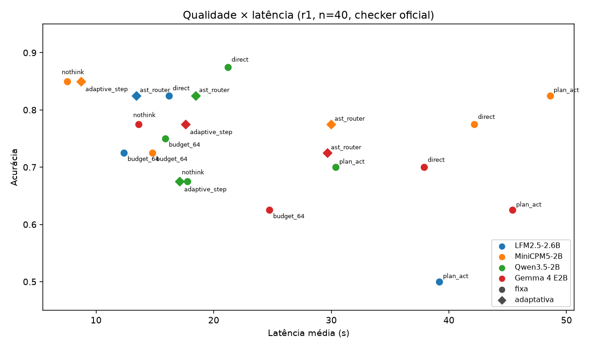
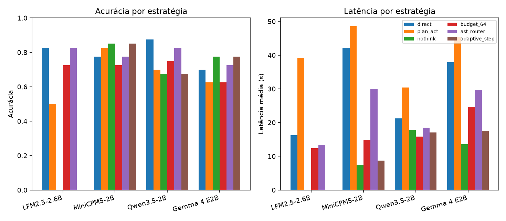
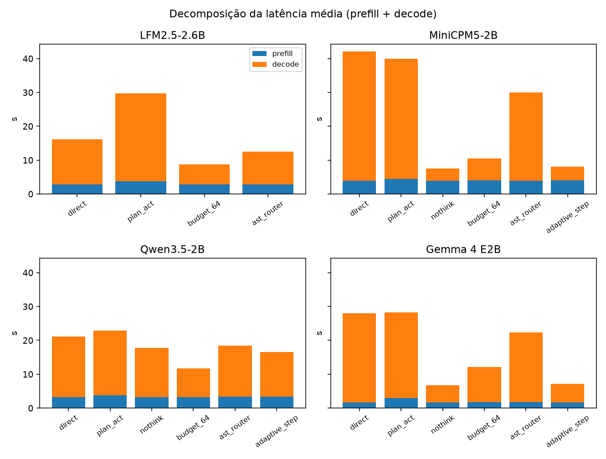

# Semana 8 — SLMs agênticos no iPhone: BFCL v4 AST

Semana 8 do calendário ISO **2026-W44** (2026-10-26 a 2026-11-01).
Números calculados dos arquivos em `results/` e `reports/slm-bfcl/`; nada foi digitado à mão.

## Inferência no iPhone × avaliação no Mac

| Etapa | Onde | O que entra |
|---|---|---|
| Inferência | **iPhone 16 Pro** (`iPhone17,1`, Version 26.6.2 (Build 23G90)), MLX Swift / `mlx-swift-lm` 3.31.4 | tokens, latência, prefill, decode, térmica, memória |
| Avaliação | **Mac**, `ast_checker` oficial (`bfcl-eval` 2026.3.23) | `valid` / tipo de falha |

O gerador deste relatório **não** relança inferência no iPhone. Reavaliar no Mac, se necessário: `.bfcl-venv/bin/python analysis/slm_bfcl/evaluate.py results/slm-bfcl/main-r1-*.json --out results/slm-bfcl/main-r1-graded.jsonl`.

## Estado desta semana

- **Concluído:** rodada 1, **880 execuções** medidas e avaliadas (4 modelos × políticas aplicáveis × 40 tarefas).
- **Não concluído:** repetição 2 — 1/4 modelos. Lacunas não são apresentadas como resultado.

## Resposta curta (só r1)

1. **Melhor acurácia:** Qwen3.5-2B `direct`, 35/40 (88%), 21.2 s/tarefa.
2. **Melhor custo-benefício na vizinhança da melhor acurácia** (até 1 tarefa a menos): MiniCPM5-2B `nothink`, 34/40 (85%) em 7.5 s.
3. **Adaptativas superam a melhor fixa em acurácia?** Não. Nenhuma política adaptativa superou a melhor fixa em nenhum modelo (Δ ≤ 0 pp).
4. **Ganho de latência sem perda:** LFM2.5-2.6B `ast_router` −2.8 s (IC95% [−5.0; −1.0])
5. **Plan+Act:** não é a melhor fixa em nenhum modelo e é a mais lenta em todos os que a rodaram.

## Cobertura experimental (r1)

| Campo | Valor |
|---|---|
| Benchmark | BFCL v4 AST (turno único; **não** avalia interações sequenciais com ferramentas) |
| Modelos | LFM2.5-2.6B, MiniCPM5-2B, Qwen3.5-2B, Gemma 4 E2B |
| Estratégias observadas | adaptive_step, ast_router, budget_64, direct, nothink, plan_act |
| Tarefas / condição | 40 (amostra congelada, seed 20261027) |
| Execuções avaliadas | 880 |
| Amostragem | greedy, temperature 0 |
| Seed de ordem | `20261027` |
| Espera térmica | `requireCoolThermal=False`, `thermalTimeoutSeconds=0` |

LFM2.5 não tem `nothink` nem `adaptive_step` nesta rodada (estratégias não aplicáveis; 160 execuções, não 240). Smoke tests (`results/slm-bfcl/smoke*.json`) ficam de fora. Checkpoints:

- `LiquidAI/LFM2.5-2.6B-MLX-4bit@04efa23776ce61ec34ec95ec34c859854c89542b`
- `mlx-community/Qwen3.5-2B-4bit@674aaa7240b91e8012fcad5d791b7dfe5ba90207`
- `mlx-community/gemma-4-e2b-it-4bit@238767527555cb75a05732a84dff5d6ba0dd6809`
- `openbmb/MiniCPM5-2B-MLX@8a9ad7539ac86281d0ac2b017ba04a5de53fe9a3`

## Tabela principal (r1, checker oficial)

A latência média inclui prefill, decode e overhead do app. Plan+Act soma o turno do plano. Tabela completa com mediana, memória e falhas: [tables.md](tables.md).

| Modelo | Estratégia | Acurácia | Latência média (s) | Prefill (s) | Decode (s) | Tokens in/out |
|---|---|---|---|---|---|---|
| **Qwen3.5-2B** | **direct** | **35/40 (88%)** | **21.2** | 3.3 | 17.9 | 459/342 |
| Qwen3.5-2B | plan_act | 28/40 (70%) | 30.4 | 3.8 | 19.2 | 1033/454 |
| Qwen3.5-2B | nothink | 27/40 (68%) | 17.7 | 3.2 | 14.5 | 461/291 |
| Qwen3.5-2B | budget_64 | 30/40 (75%) | 15.9 | 3.3 | 8.5 | 459/196 |
| Qwen3.5-2B | ast_router | 33/40 (82%) | 18.5 | 3.4 | 15.0 | 459/289 |
| Qwen3.5-2B | adaptive_step | 27/40 (68%) | 17.1 | 3.3 | 13.2 | 460/264 |
| MiniCPM5-2B | direct | 31/40 (78%) | 42.2 | 4.0 | 38.2 | 395/565 |
| MiniCPM5-2B | plan_act | 33/40 (82%) | 48.6 | 4.4 | 35.5 | 904/603 |
| **MiniCPM5-2B** | **nothink** | **34/40 (85%)** | **7.5** | 4.0 | 3.5 | 397/65 |
| MiniCPM5-2B | budget_64 | 29/40 (72%) | 14.8 | 4.0 | 6.5 | 395/118 |
| MiniCPM5-2B | ast_router | 31/40 (78%) | 30.0 | 3.9 | 26.0 | 395/389 |
| MiniCPM5-2B | adaptive_step | 34/40 (85%) | 8.7 | 4.1 | 4.0 | 396/72 |
| **LFM2.5-2.6B** | **direct** | **33/40 (82%)** | **16.2** | 2.8 | 13.4 | 264/249 |
| LFM2.5-2.6B | plan_act | 20/40 (50%) | 39.2 | 3.8 | 26.0 | 692/606 |
| LFM2.5-2.6B | budget_64 | 29/40 (72%) | 12.4 | 2.8 | 5.9 | 264/136 |
| LFM2.5-2.6B | ast_router | 33/40 (82%) | 13.4 | 2.8 | 9.8 | 264/193 |
| Gemma 4 E2B | direct | 28/40 (70%) | 37.9 | 1.7 | 26.3 | 245/437 |
| Gemma 4 E2B | plan_act | 25/40 (62%) | 45.4 | 3.0 | 25.2 | 623/532 |
| **Gemma 4 E2B** | **nothink** | **31/40 (78%)** | **13.6** | 1.7 | 5.1 | 243/92 |
| Gemma 4 E2B | budget_64 | 25/40 (62%) | 24.7 | 1.8 | 10.4 | 245/188 |
| Gemma 4 E2B | ast_router | 29/40 (72%) | 29.7 | 1.8 | 20.5 | 245/355 |
| Gemma 4 E2B | adaptive_step | 31/40 (78%) | 17.6 | 1.6 | 5.5 | 243/101 |

## Adaptativas × melhor fixa (pareado por tarefa, IC95% bootstrap)

| Modelo | Melhor fixa | Política | Δ acurácia (pp) [IC95%] | Δ latência (s) [IC95%] | Decisões |
|---|---|---|---|---|---|
| Qwen3.5-2B | direct | ast_router | −5.0 [−12.5; +0.0] | −2.8 [−7.1; +1.6] | nothink 11, direct 29 |
| Qwen3.5-2B | direct | adaptive_step | −20.0 [−32.5; −7.5] | −4.1 [−9.5; +1.7] | nothink 35, budget_64 5 |
| MiniCPM5-2B | nothink | ast_router | −7.5 [−17.5; +2.5] | +22.4 [+15.1; +30.1] | nothink 11, direct 29 |
| MiniCPM5-2B | nothink | adaptive_step | +0.0 [+0.0; +0.0] | +1.2 [+0.3; +2.2] | nothink 35, budget_64 5 |
| LFM2.5-2.6B | direct | ast_router | +0.0 [−7.5; +7.5] | −2.8 [−5.0; −1.0] | budget_64 11, direct 29 |
| Gemma 4 E2B | nothink | ast_router | −5.0 [−17.5; +7.5] | +16.0 [+10.5; +21.4] | nothink 11, direct 29 |
| Gemma 4 E2B | nothink | adaptive_step | +0.0 [+0.0; +0.0] | +4.0 [+1.0; +7.0] | nothink 35, budget_64 5 |

MiniCPM5 AdaptiveStep vs NoThink: +0.0 pp, +1.2 s. Qwen3.5 AdaptiveStep vs Direct: −20.0 pp [−32.5; −7.5].

## Figuras







## Oracle retrospectivo (limite superior; não é política executável)

| Modelo | Melhor fixa | Oracle fixas | Oracle + adaptativas | Teto sobre a melhor fixa |
|---|---|---|---|---|
| Qwen3.5-2B | direct 35/40 | 36/40 | 36/40 | +1 |
| MiniCPM5-2B | nothink 34/40 | 38/40 | 38/40 | +4 |
| LFM2.5-2.6B | direct 33/40 | 37/40 | 37/40 | +4 |
| Gemma 4 E2B | nothink 31/40 | 34/40 | 34/40 | +3 |

União das melhores fixas: 38/40; interseção: 25/40; nenhuma resolve: 2. Exclusivas: Gemma 4 E2B (simple_python_35).

## Repetição 2 (não tratar o bloco como estudo fechado)

Seed de ordem `r2-20261027`. Greedy / temperature 0; o seed só muda a ordem.

- **MiniCPM5-2B:** completa (80 execuções avaliadas). nothink 34/40 → 34/40, concordância 40/40, latência 7.5 s → 6.0 s; adaptive_step 34/40 → 34/40, concordância 40/40, latência 8.7 s → 6.9 s.
- **LFM2.5-2.6B:** ausente. Não entra como resultado concluído.
- **Gemma 4 E2B:** incompleta — 47/80 execuções medidas no iPhone ([rep2-gemma4.json](../../../results/slm-bfcl/rep2-gemma4.json); térmica no início: nominal 11, fair 36), sem avaliação no Mac. Não entra como resultado concluído.
- **Qwen3.5-2B:** ausente. Não entra como resultado concluído.

## Resultados negativos e limitações

- **Adaptativas vs melhor fixa:** nenhum ganho de acurácia. AdaptiveStep no Qwen3.5: −20.0 pp (IC95% [−32.5; −7.5]).
- **n = 40 por condição.** Diferenças abaixo de ~10 pp em geral cruzam o zero no IC95% bootstrap pareado.
- **Térmica:** 879/880 jobs com `thermal_before=serious`; 880/880 com `thermal_after=serious`. Fora de `serious`: MiniCPM5-2B plan_act irrelevance_30 (fair→serious). O protocolo **não** espera esfriar (`requireCoolThermal=false`). Latências valem para o aparelho **quente e carregando**.
- **BFCL v4 AST** pontua a primeira resposta de turno único. **Não avalia interações sequenciais com ferramentas** (não há oráculo de diálogo nem estado entre turnos). ActionAware / ToolSandbox não entram nesta semana.
- MiniCPM5 e LFM2.5 dependem do parser no Mac para o formato nativo; o pacote `mlx-swift-lm` 3.31.4 não cobre esses formatos por completo.
- A repetição 2 dos outros três modelos **não está concluída** e não deve ser lida como estabilidade geral.

## Reprodutibilidade

Manifesto com hashes, versões, seeds e comandos: [MANIFEST.md](MANIFEST.md). Evidência bruta (sem duplicar dados):

- Amostra congelada: [../../slm-bfcl/selection.json](../../slm-bfcl/selection.json)
- Sessões r1: [main-r1-gemma4.json](../../../results/slm-bfcl/main-r1-gemma4.json), [main-r1-lfm25.json](../../../results/slm-bfcl/main-r1-lfm25.json), [main-r1-minicpm5.json](../../../results/slm-bfcl/main-r1-minicpm5.json), [main-r1-qwen35.json](../../../results/slm-bfcl/main-r1-qwen35.json)
- Linhas avaliadas: [main-r1-graded.jsonl](../../../results/slm-bfcl/main-r1-graded.jsonl)
- Avaliador (Mac): [../../../analysis/slm_bfcl/evaluate.py](../../../analysis/slm_bfcl/evaluate.py)
- Análise: [../../../analysis/slm_bfcl/analyze.py](../../../analysis/slm_bfcl/analyze.py)
- Estudo narrativo prévio: [../../slm-bfcl/REPORT.md](../../slm-bfcl/REPORT.md)

Gerar de novo (só Mac, sem iPhone):

```bash
python3 analysis/weekly/generate.py 2026-W44
```
