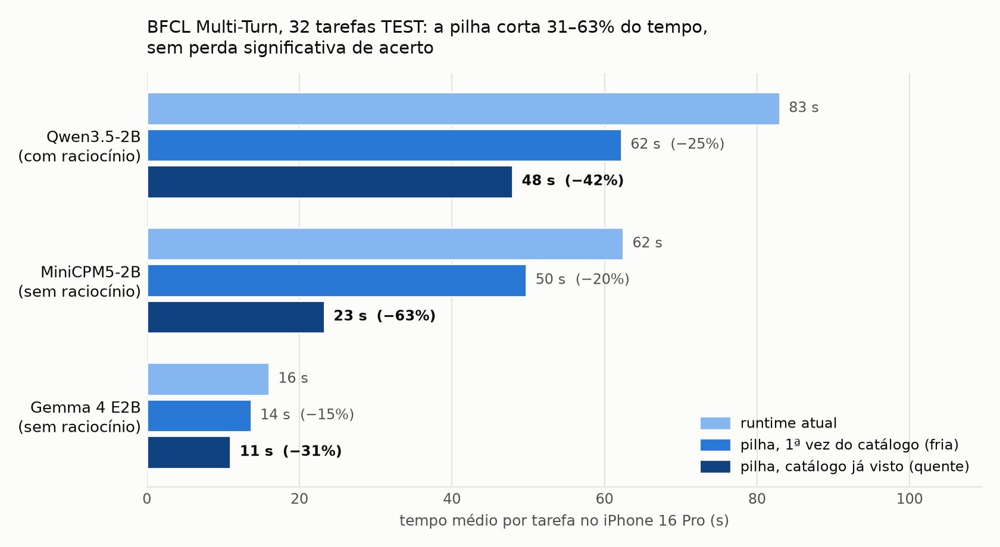

# Semana 9: agentes multi-turno no iPhone, 31–63% mais rápidos

Período da entrega: **2026-11-02 a 2026-11-13** (ISO 2026-W45 e W46). A partir desta semana, cada semana vai de uma
entrega à seguinte e não tem mais 7 dias fixos. Os números abaixo vêm dos arquivos citados em cada seção; nenhum foi
digitado de memória.

## Resumo

1. **A pergunta mudou de escala.** No status de 29/10, o item "Multi-turno oficial" (BFCL Multi-Turn) estava
   **não começou**. Nesta semana ele foi do primeiro recorte até um **TEST congelado**, com tarefas de vários passos,
   ferramentas com estado e o simulador e o scorer oficiais do `bfcl-eval`.
2. **Resultado principal: a "pilha" de runtime** (prefixo persistente + DAC com guardas de decode) deixou três SLMs
   **31% a 63% mais rápidos por tarefa** nas 32 tarefas TEST, sem perda significativa de acerto. O protocolo e os
   hashes do código foram congelados antes de rodar.
3. **Resultados negativos medidos e explicados:**
   - a política Adaptive do BFCL Non-Live não economiza;
   - orçamentos de raciocínio não passam no portão pré-registrado;
   - PACA e o controle do raciocínio durante o decode não valem a pena;
   - o LoRA de SFT agêntico piora o acerto no Multi-Turn. A conversão do LoRA foi verificada, então a causa não é erro
     nosso.
4. **Engenharia:**
   - o app foi separado em dois (Bench e Chat), com um núcleo compartilhado;
   - o servidor no iPhone é usado pelo harness do Mac;
   - a aba Ao vivo mostra o progresso;
   - os adaptadores LoRA foram integrados;
   - três bugs que distorciam medições foram encontrados e corrigidos.



## Resultado principal: TEST final (32 tarefas BFCL Multi-Turn, iPhone 16 Pro)

| Modelo (estratégia) | Acerto: atual → pilha | Atual (s/tarefa) | Pilha fria | **Pilha quente** | IC95% do Δ quente |
|---|---|---|---|---|---|
| Qwen3.5-2B (com raciocínio) | 8/32 → 7/32 | 83,0 | 62,2 (−25%) | **48,0 (−42%)** | [−47,9; −25,4] s |
| MiniCPM5-2B (sem raciocínio) | 9/32 → 9/32 | 62,5 | 49,8 (−20%) | **23,3 (−63%)** | [−49,5; −31,2] s |
| Gemma 4 E2B (sem raciocínio) | 2/32 → 2/32 | 16,0 | 13,7 (−15%) | **11,0 (−31%)** | [−5,6; −4,5] s |

Fonte: [reports/runtime/test-*.md](../../runtime/), [test-cold-warm.txt](../../runtime/test-cold-warm.txt),
protocolo [PROTOCOL-TEST.md](../../runtime/PROTOCOL-TEST.md).

O critério congelado tinha duas partes:
- o IC95% do Δ quente inteiro abaixo de zero;
- perda líquida de no máximo 1 de 32 tarefas, sem perda significativa.

**Os três modelos passaram nas duas.** No Qwen3.5, a pilha perdeu as tarefas 23 e 161 e ganhou a 12: perda líquida
de 1, McNemar p = 1,0. *Fria* é a primeira vez que um catálogo de ferramentas aparece; *quente* é quando ele já foi
visto, que é o caso normal num app.

**Como funciona:**
- **Prefixo persistente** (ataca o prefill): o estado do modelo depois de ler "sistema + ferramentas" (~4,7 mil
  tokens) é gravado em disco e recarregado em ~15–70 ms, em vez de ~12–15 s.
- **DAC + guardas** (ataca o decode):
  - fecha o raciocínio em 512 tokens;
  - corta a mesma chamada repetida na mesma resposta;
  - dá ao modelo uma única chance de sair de um laço antes de encerrar o turno.

As duas peças atacam gargalos diferentes e por isso se somam. Explicação completa e código:
[reports/runtime/README.md](../../runtime/README.md).

## O que foi feito, na ordem

| Data | Trabalho | Resultado | Evidência |
|---|---|---|---|
| 04/11 | Primeiro recorte BFCL Multi-Turn: 4 SLMs × {melhor fixa, nothink/direct, política A} na fatia congelada (12 DEV / 32 TEST, seed 20261104) | Política A (para laços) corta o tempo no Qwen3.5 (−32 s, IC [−43; −21]) e no LFM2.5 (−75 s) sem mudar o acerto; no MiniCPM5 e no Gemma 4 fica mais lenta ou perde acerto | [`analysis/bfcl_mt/analyze.py`](../../../analysis/bfcl_mt/analyze.py), [`results/bfcl-mt/slice.json`](../../../results/bfcl-mt/slice.json) |
| 05/11 | BFCL v4 Non-Live no iPhone: piloto, DEV 80 e TESTE 160 de Direct × Reasoning × Adaptive (pré-registrado) | Adaptive empata com a Reasoning em acerto (130 × 129/160; H1 passa), mas não é mais rápida (H2 não passa, +1,7 s) | [bfcl-nonlive/REPORT.md](../../bfcl-nonlive/REPORT.md) |
| 05/11 | App separado em **MobileLLMBench** (bench) e **MobileLLMChat** (produto), com `MobileLLMCore` compartilhado; chat com harness real do iPhone, memória do usuário e novo visual | E2E do chat com o modelo da Apple passou no iPhone (test1/2/3/5, registrado em 05/11) | [README](../../../README.md#apps-ios-mobilellmbench-e-mobilellmchat), [chat MVP](../../chat-agent-mvp/REPORT.md) |
| 05–06/11 | Estudo B (Non-Live): orçamentos de raciocínio 128/256/512 no DEV 80 | Nenhum passa no portão pré-registrado (melhor: Budget-512, −8% de tokens, abaixo do corte de 10%); o TESTE-2 não roda | [budget-dev-qwen35-tables.md](../../bfcl-nonlive/budget-dev-qwen35-tables.md) |
| 06/11 | **Estudo DAC** (Multi-Turn, Qwen3.5, DEV 12 × 3 rodadas): cache, recuperação, guardas de decode | Cache incremental: 380 → 65 s por tarefa (−83%). DACS: −16% (IC < 0), acerto igual, zera os passos no teto e os laços | [dac/dev-r1-r3.md](../../dac/dev-r1-r3.md), [dac/PROTOCOL.md](../../dac/PROTOCOL.md) |
| 06/11 | PACA (orçamento pelo progresso) e sinais no decode | Os dois descartados: PACA ≈ orçamento fixo e perde a 163; o controle no decode só economiza 3,1% | [dac/paca1.md](../../dac/paca1.md), [dac/decode1.md](../../dac/decode1.md) |
| 07/11 | Microbenchmarks de runtime: custo por passada, rascunho da gramática, prefixo frio/quente | Verificar 2 tokens custa o mesmo que gerar 1; rascunho com saída idêntica, mas −5% de ponta a ponta; prefixo: TTFT 14 → 1,1 s | [`results/runtime/`](../../../results/runtime/), [runtime/rt1-eval.md](../../runtime/rt1-eval.md) |
| 07/11 | **Pilha 2×2** (prefixo × DACS), Qwen3.5, DEV × 3 rodadas | −39% (IC [−47,7; −14,0] s), efeitos aditivos, acerto igual | [runtime/stack-all.md](../../runtime/stack-all.md), [PROTOCOL-stack.md](../../runtime/PROTOCOL-stack.md) |
| 07–08/11 | LoRA de SFT do autor (`davidoneil/agent-sft-*-lora`) integrado ao app e medido no DEV | Piora o acerto: Qwen3.5 5 → 2/12, MiniCPM5 5 → 3/12. Ver "SFT" abaixo | [runtime/sft-*.md](../../runtime/), [PROTOCOL-sft.md](../../runtime/PROTOCOL-sft.md) |
| 08/11 | Verificação do LoRA no Mac (runtime × fundido pelo PEFT; 4 bits × bf16) | Conversão correta; a quantização não explica a queda | [`results/sft-check/qwen35.json`](../../../results/sft-check/qwen35.json) |
| 09/11 | Pilha em mais SLMs (LFM2.5, Gemma 4, Qwen3.5 de novo), DEV, fria e quente | Δ com IC < 0 nos quatro modelos (MiniCPM5: só uma rodada, sem caso quente); o ganho vem do prefixo nos modelos sem raciocínio e da DAC nos que raciocinam muito. No LFM2.5, o prefixo não funcionou (bug corrigido em 10/11): o ganho dele é só da DAC | [runtime/models-*.md](../../runtime/), [PROTOCOL-models.md](../../runtime/PROTOCOL-models.md) |
| 09–10/11 | **TEST final congelado** (32 tarefas × 3 SLMs × {atual, pilha fria, pilha quente}, 288 execuções) | Critério cumprido nos três | [PROTOCOL-TEST.md](../../runtime/PROTOCOL-TEST.md), [test-*.md](../../runtime/) |
| 10/11 | **LFM3-1.7B** num build separado (`mlx-swift-lm` novo + camada de compatibilidade); Qwen3.5 de novo no mesmo build | LFM3 6/12 contra 4/12 do Qwen3.5 (acerta tudo o que o Qwen acerta, mais a 163 e a 169; p = 0,5); pilha quente −32% no LFM3 e −47% no Qwen3.5, acerto igual | [runtime/README.md#lfm3-17b-build-novo-dev](../../runtime/README.md#lfm3-17b-build-novo-dev), [PROTOCOL-lfm3.md](../../runtime/PROTOCOL-lfm3.md) |
| 10/11 | Documentação e limpeza: README principal, relatório do estudo, figura; MVP Android retirado do repo (continua no git) | — | [README](../../../README.md), [reports/runtime/README.md](../../runtime/README.md) |

## Resultados negativos (entram no TCC)

| Tentativa | Veredito | Por quê |
|---|---|---|
| Adaptive Direct/Reasoning (Non-Live, TESTE 160) | mantém o acerto, não economiza | +1,7 s contra a Reasoning; das 12 tarefas que só a Direct resolve, a regra leve captura 1 |
| Orçamentos de raciocínio 128/256/512 (Non-Live, DEV 80) | não passam no portão | Cortar o raciocínio perde acerto em `irrelevance` (11 → 8/16) |
| PACA: orçamento pelo progresso (Multi-Turn) | não promissora | Os passos que derivam argumentos de resultados anteriores precisam de mais raciocínio, não de menos |
| Controle do raciocínio no decode | não vale | Os sinais existem (repetição cedo), mas a economia além do orçamento fixo é de 3,1%, numa tarefa que falha sempre |
| Rascunho da gramática (tags XML) | correto, pequeno | Saída idêntica e −7% no decode, mas −5% de ponta a ponta; somado ao prefixo não ajuda |
| **LoRA de SFT agêntico** | piora o acerto no Multi-Turn | Ver abaixo |

### SFT: o que foi verificado

Integramos ao app os adaptadores do autor, aplicados em tempo de execução sobre a base MLX de 4 bits.

**No DEV:**

| Modelo | Base | SFT |
|---|---|---|
| Qwen3.5 | 5/12 | 2/12 |
| MiniCPM5 | 5/12 | 3/12 |

**Três hipóteses foram testadas:**

1. **Erro na aplicação do LoRA: descartado.** O LoRA em tempo de execução dá os mesmos logits que o LoRA somado nos
   pesos pela fórmula do PEFT: Δ máx. 0,22, contra 8,0 do efeito do próprio LoRA.
2. **Quantização em 4 bits: descartada.** O 4 bits afasta a base sem LoRA mais (Δ 6,5) do que afasta o modelo com
   LoRA (Δ 4,3), e a base em 4 bits acerta 5/12.
3. **Domínio do treino: compatível com o observado.**
   - No mesmo prompt ("comprar 100 ações da AAPL"), a base planeja: consulta a cotação e depois faz a ordem. O SFT vai
     direto para `place_order`.
   - Do mix de treino (61 mil exemplos), um terço é chamada única (xLAM-60k), e o BFCL Multi-Turn cobra chamadas
     encadeadas sobre estado.

Isso **não** prova que o SFT é ruim em geral: ele foi feito para chamar ferramentas de forma ampla, e aqui medimos um
único benchmark. Os adaptadores ficam integrados para avaliações futuras.

## Bugs e lições que mudaram números

| Problema | Efeito | Correção |
|---|---|---|
| `PrefixStore` guardava só 4 prefixos | Com 12 catálogos no DEV, ~metade das execuções "quentes" com prefixo refazia o prefixo | Limite 48 (~95 MB cada); o Qwen3.5 quente passou de −40% para −43% |
| `PrefixStore` recusava o cache de convolução da família LFM | No DEV, o LFM2.5 nunca usou o prefixo persistente (o ganho dele é só da DAC) | Aceita um estado por camada e confere o número de estados ao carregar; o TEST não foi afetado |
| Nome mDNS do iPhone resolve para vários IPv6, alguns sem rota | O cliente do BFCL não achava o iPhone | Repasse local pelo cabo USB (`analysis/runtime/iphone_proxy.py`) |
| Prefixo salvo compartilhado entre a base e o SFT | O SFT leria um estado calculado sem o LoRA | A chave passou a incluir o adaptador |
| Qwen3.5 SFT emite a 2ª chamada sem `<tool_call>` | A 2ª chamada se perdia | Recupera chamadas sobrando no texto (0 de 1062 passos da base afetados) |
| O `evaluate` do BFCL troca `_` por `/` no nome do modelo | Modelos com `_` ficavam sem nota | Alias com `/` registrado |
| Mac com a tampa fechada / iPhone fora da rede | Rodadas paradas de madrugada | `caffeinate -dims`, tampa aberta, espera pelo iPhone e retomada sem refazer o que já foi gravado |

## Desvios de protocolo (registrados)

- **Pilha 2×2 (DEV):** o critério pré-registrado era o *prefixo sozinho* ≥ 20% quente. Ele não passou (−12%). A
  decisão de levar a *pilha completa* ao TEST foi tomada depois de ver o DEV, que existe para essa escolha; as 32 TEST
  seguiam intocadas. Está escrito em [PROTOCOL-TEST.md](../../runtime/PROTOCOL-TEST.md).
- **MiniCPM5 sem raciocínio:** o `</think>` dele não é um token único, então o orçamento de raciocínio não funciona.
  Com raciocínio, o SFT entra em laço.
- **TEST interrompido em 09/11, 13:14:** o iPhone saiu da rede por mais de 1 h. Foi retomado às 23:39 sem refazer
  execuções e sem apagar prefixos. Uma edição acidental num arquivo congelado foi revertida, e os 10 hashes foram
  conferidos antes de relançar.

## Limitações

- **Acerto baixo:** os SLMs de 2B acertam 2 a 9 das 32 tarefas Multi-Turn. A pilha acelera sem piorar, mas não sobe o
  acerto; parte do ganho vem de desistir mais cedo em tarefas perdidas.
- **Uma rodada por condição no TEST:** o tempo varia com a térmica entre dias, por isso a comparação é sempre pareada
  dentro da mesma sessão.
- **O caso quente supõe um catálogo de ferramentas repetido:** é natural num app; no BFCL, cada tarefa traz o seu.

## Até a entrega (11–13/11) e depois

Planejado (não feito ainda):

1. **Capítulo de resultados do TCC** com as tabelas e a figura do TEST.
2. **TEST do LFM3** no build novo (32 tarefas × {atual, pilha fria, pilha quente}), com o Qwen3.5 no mesmo build
   como comparação de acerto. O DEV já foi feito (10/11) e está na tabela acima.
3. **Escolha de modelo por tarefa:** Qwen3.5 e MiniCPM5 acertam tarefas diferentes no DEV (juntos, 7/12, contra 5/12
   de cada um). Antes de usar o iPhone, analisar no Mac se algum sinal do pedido prevê qual modelo acerta.
4. **SFT com trajetórias com estado,** se fizer sentido para o TCC.

## Reprodução (sem iPhone)

```bash
BENCH_SLM=qwen35 .bfcl-venv/bin/python analysis/bfcl_mt/analyze_dac.py reports/runtime/test-qwen35.md tqA tqB \
  --conds rt-base-kv,dacs-persist-kv --ref rt-base-kv
python3 analysis/runtime/cold_warm.py reports/runtime/test-qwen35.json rt-base-kv dacs-persist-kv tqA tqB
python3 analysis/runtime/figures.py
```

Com iPhone: as cadeias em [`analysis/runtime/chains/`](../../../analysis/runtime/chains/README.md). Resultados brutos
(trace por passo, saídas e notas do BFCL) em `results/bfcl-mt/dac/<rodada>/`.
